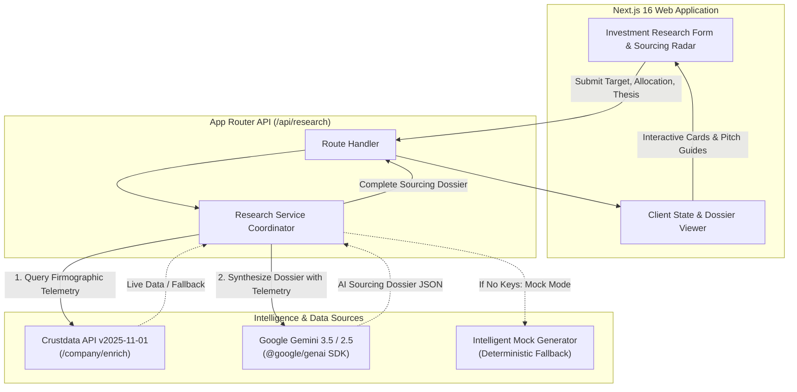

# VentureLens AI ⚡

> **Autonomous Venture Intelligence, Founder Sourcing & Investment Diligence Platform**  
> *Engineered for Venture Capital Junior Analysts, Associates, and Investment Principals.*

[](https://nextjs.org/)
[](https://react.dev/)
[](https://www.typescriptlang.org/)
[](https://tailwindcss.com/)
[](https://ai.google.dev/)
[](https://crustdata.com/)
[](LICENSE)

---

## 📌 Executive Summary

Venture capital analysts spend 15–20 hours every week manually digging through scattered web footprint data, news articles, LinkedIn profiles, and registry filings to source founders, vet market theses, and prepare first-call agendas.

**VentureLens** transforms this workflow into an autonomous, high-conviction decision pipeline. By coupling real-time verified company firmographics (**Crustdata API v2025-11-01**) with autonomous multi-agent reasoning (**Google Gemini 3.5 / 2.5 via `@google/genai`**), VentureLens discovers target startups, models capital deployment, analyzes founder pedigree, synthesizes investment risks, and delivers ready-to-run 30-minute founder screening call guides.

---

## 🚀 Key Features

### 1. 🎯 Precision Sourcing & Contender Radar
- Search by **exact startup domain** (e.g., `contravault.com`) or **sector thesis** (e.g., `GovTech AI`, `Developer Tooling in India`, `Supply Chain Automation`).
- Surfaces the primary target alongside top peer contenders in the same market space.
- Candidate scoring (0–100 match rating) evaluating thesis fit, defensibility moat, and stage alignment.

### 2. 💰 Capital Deployment & Check Size Allocation
- Accepts target fund deployment (e.g., `$1.0M Seed check` or `$2.0M Series A tranche`).
- Dynamically models recommended check size per candidate, projected target ownership ranges (e.g., `10% - 14%`), and syndication strategies.

### 3. 👥 Founder Pedigree & Background Verification
- Extracts verified founder profiles with track record highlights.
- Generates high-signal pedigree tags (e.g., `Ex-Google`, `IIT Bombay`, `2x Founder`, `Ex-McKinsey`).
- Direct links to professional networks and founder footprints.

### 4. 📞 30-Minute Founder Screening Call Guide & Outbound Pitch Draft
- **Timed Call Agenda**: Structured 30-minute block breakdown (Origin Story & Insight $\rightarrow$ Product Architecture & Defensibility $\rightarrow$ Unit Economics & ACV $\rightarrow$ Round Dynamics & Cap Table).
- **Categorized Probing Questions**: Prioritized diligence questions across *Unit Economics*, *GTM & Moat*, *Product Architecture*, and *Defensibility*.
- **Target Signals to Listen For**: Explicit benchmarks detailing what positive founder answers sound like vs. red flags.
- **One-Click Cold Outreach**: Auto-drafted cold email tailored to the founder and recommended check size ready to copy.

### 5. 📑 Preliminary Investment Dossier
- **Thesis Assessment**: Quantitative alignment score (0–100) with key alignment drivers and divergence watchpoints.
- **Positive Signals Matrix**: Moat, Traction, Team, and Market catalysts mapped to evidence sources.
- **Startup Business Model Risks**: Critical and moderate operational risks paired with concrete diligence watchpoints.
- **Missing Evidence Checklist**: Identifies data gaps required before term sheet issuance.
- **Verified Sources & Evidence**: Traceable firmographic citations with telemetry confidence scores.

### 6. 🛡️ Dual-Engine Architecture with Graceful Fallback
- Connects directly to **Crustdata Company Enrichment API** and **Google Gemini SDK**.
- Includes zero-setup **intelligent mock generation** so the platform runs seamlessly even without configured API credentials for evaluation or testing.

---

## 🏛️ System Architecture



---

## 🛠️ Technology Stack

| Layer | Technology | Purpose |
| :--- | :--- | :--- |
| **Framework** | [Next.js 16.4.3](https://nextjs.org/) | App Router, Server Components & Route Handlers |
| **UI Library** | [React 19.3.0](https://react.dev/) | Component lifecycle & interactive UI |
| **Language** | [TypeScript 5.x](https://www.typescriptlang.org/) | End-to-end type safety |
| **Styling** | [Tailwind CSS v4](https://tailwindcss.com/) | Modern utility-first responsive styling |
| **Icons** | [Lucide React](https://lucide.dev/) | Clean, consistent UI iconography |
| **Company Enrichment**| [Crustdata API](https://crustdata.com/) | Firmographics, headcount, funding & web telemetry |
| **Reasoning Agent** | [Google Gemini 3.5](https://ai.google.dev/) | Investment thesis evaluation & candidate synthesis |

---

## 📁 Repository Structure

```
VentureLens/
├── src/
│   ├── app/
│   │   ├── api/
│   │   │   └── research/
│   │   │       └── route.ts             # POST API endpoint for research synthesis
│   │   ├── favicon.ico
│   │   ├── globals.css                  # Tailwind CSS root imports & design tokens
│   │   ├── layout.tsx                   # Root layout with Geist font & SEO meta
│   │   └── page.tsx                     # Main dashboard page
│   ├── components/
│   │   ├── Header.tsx                   # Top navigation & system status badge
│   │   ├── ResearchForm.tsx             # Sourcing query form & 1-click preset selector
│   │   ├── ResearchResults.tsx          # Sourcing radar & active candidate tab manager
│   │   ├── brief/                       # Detailed investment memo components
│   │   │   ├── CompanyOverviewCard.tsx  # Company firmographics & market position
│   │   │   ├── FounderQuestionsCard.tsx # Diligence questions with rationale & signals
│   │   │   ├── MissingEvidenceCard.tsx  # Data gaps & verification checklist
│   │   │   ├── PositiveSignalsCard.tsx  # Moat, traction & team signals
│   │   │   ├── RisksConcernsCard.tsx    # Business risks & watchpoints
│   │   │   ├── SourcesEvidenceCard.tsx  # Crustdata telemetry & citations
│   │   │   └── ThesisAssessmentCard.tsx # Thesis fit score & analysis
│   │   ├── sourcing/
│   │   │   ├── CandidateCard.tsx        # High-level contender match cards
│   │   │   └── FounderCallSection.tsx   # 30-min screening call agenda & cold outreach
│   │   └── states/
│   │       ├── EmptyState.tsx           # Initial empty radar state
│   │       ├── ErrorState.tsx           # Retryable error boundary state
│   │       └── LoadingState.tsx         # Multi-phase telemetry loading skeleton
│   ├── lib/
│   │   └── mockData.ts                  # Deterministic fallback sourcing dossiers
│   ├── services/
│   │   ├── crustdataService.ts          # Crustdata Company Enrichment v2025-11-01 client
│   │   ├── geminiResearchAgent.ts       # Gemini prompt engineering & JSON schema parser
│   │   └── researchService.ts           # Dual-engine orchestration layer
│   └── types/
│       └── research.ts                  # TypeScript interfaces for dossiers, briefs & candidates
├── .env.example                         # Environment variable template
├── .gitignore                           # Git ignore configuration
├── next.config.ts                       # Next.js configuration
├── package.json                         # Project dependencies and npm scripts
├── postcss.config.mjs                   # PostCSS configuration for Tailwind v4
├── README.md                            # Comprehensive project documentation
└── tsconfig.json                        # TypeScript configuration
```

---

## ⚡ Quick Start & Local Setup

### 1. Prerequisites
- **Node.js**: v18.18.0 or higher (v20+ recommended)
- **npm** (or `pnpm` / `yarn`)
- **Git**

### 2. Clone the Repository
```bash
git clone https://github.com/shubhamodi/VentureLens.git
cd VentureLens
```

### 3. Install Dependencies
```bash
npm install
```

### 4. Configure Environment Variables
Copy `.env.example` to `.env.local`:
```bash
cp .env.example .env.local
```

Open `.env.local` and add your API credentials:
```env
# 1. Crustdata API Token (Firmographic enrichment)
CRUSTDATA_API_KEY=your_crustdata_api_key_here

# 2. Google Gemini API Key (Autonomous investment reasoning)
GEMINI_API_KEY=your_gemini_api_key_here
```

> **Note:** If either key is omitted, VentureLens gracefully activates intelligent mock mode with realistic venture data so you can test all UI flows instantly.

### 5. Run Development Server
```bash
npm run dev
```

Open your browser and navigate to [http://localhost:3000](http://localhost:3000).

---

## 🧪 Preset Research Scenarios

VentureLens includes one-click presets for immediate testing:
1. **GovTech & Tender AI ($1M Seed)**: Evaluating vertical AI platforms automating complex government procurement and tender bid risk analysis (`contravault.com`).
2. **Developer Infra ($2M Series A)**: Developer tooling and API orchestration layers built out of India with organic global developer adoption (`devmesh-sample.io`).
3. **Supply Chain AI ($500K Seed)**: Vertical AI SaaS standardizing freight workflow automation in India (`cargoai-sample.in`).

---

## 📡 API Reference

### `POST /api/research`

Synthesizes a full Sourcing Dossier combining live firmographic telemetry and autonomous reasoning.

#### Request Body
```json
{
  "domain": "contravault.com",
  "allocatedFunds": "$1.0M Seed Check",
  "stage": "Seed",
  "geography": "India",
  "thesis": "Seeking vertical AI platforms automating complex government procurement with high workflow lock-in."
}
```

#### Response (Excerpt)
```json
{
  "id": "dossier-171928374",
  "metadata": {
    "generatedAt": "2026-10-24T11:00:00.000Z",
    "targetSectorOrDomain": "contravault.com",
    "allocatedFunds": "$1.0M Seed Check",
    "stage": "Seed",
    "geography": "India",
    "isSampleData": false
  },
  "capitalDeploymentStrategy": {
    "totalAllocation": "$1.0M Seed Check",
    "targetCheckPerDeal": "$750K - $1M",
    "candidateCount": 3,
    "recommendedDeploymentSummary": "Deploy lead check into primary candidate with reserve allocation for follow-on syndicate tranches."
  },
  "candidates": [
    {
      "id": "candidate-1",
      "companyName": "ContraVault",
      "domain": "contravault.com",
      "matchScore": 94,
      "recommendedCheckSize": "$750K - $1M",
      "projectedOwnership": "10% - 14%",
      "founders": [
        {
          "name": "Arjun Mehta",
          "role": "CEO & Co-founder",
          "pedigreeTags": ["Ex-Google", "IIT Bombay", "2x Founder"]
        }
      ]
    }
  ]
}
```

---

## 🤝 Contributing

1. Fork the Project repository
2. Create your Feature Branch (`git checkout -b feature/AmazingFeature`)
3. Commit your Changes (`git commit -m "feat: add AmazingFeature"`)
4. Push to the Branch (`git push origin feature/AmazingFeature`)
5. Open a Pull Request

---

## 📄 License

Distributed under the MIT License. See `LICENSE` for more information.

---

<p align="center">
  <b>Built for Venture Capital Teams seeking an unfair advantage in early-stage dealflow.</b>
</p>
